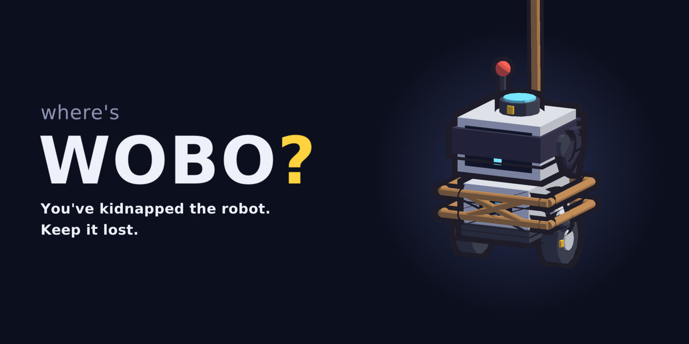

# Where's Wobo?


*Keep Wobo lost: sabotage an autonomous robot's attempts to localize itself.*

You've kidnapped Wobo. Now it's fully-recharged and ready to find out where it is. Wobo has scanned the current floor plan and is equipped with a colourized 2D LiDAR. Stop it from finding its true location: disrupt its perception, confuse its odometry, or even kidnap it again. 

## Gameplay / Controls

| Input | Action |
|---|---|
| `1`-`8` / click | Use an action (Kidnap, Road Block, Magnet: click a spot, drag to aim or turn) |
| `Space` / `P` | Pause |
| `[` `]` | Simulation speed 1x / 2x (also the play and fast-forward buttons under the hour clock) |
| Drag, right-drag | Pan |
| Wheel, pinch | Zoom |
| `B` / `V` / `C` | Show beliefs (also a checkbox in the menu) / scan lines / planner candidates |
| `Tab` | Top-down debug view |
| `F` | Centre on Wobo |
| `H` | Help |

What you see: the solid robot is the real Wobo. The see-through pink Wobo is where it *thinks* it is, pink arrows are its particles, and pink rings are its strongest hypotheses. The white rays are its last scan, and the dashed ring is how far it can currently see. A red tether runs from Wobo to its guess, labelled with how far off it is. When the guess is genuinely right, the red capture ring around Wobo and an outline around the status box fill up as it locks on; once a lock has held for a second the screen edges pulse and a countdown appears. The pink bar is Wobo's own confidence, which can be confidently wrong. The run ends when Wobo's estimate is *actually* right (checked against ground truth) for four seconds straight. Keep it lost to the end of hour 24 and you win.

Each hour runs once round the clock beside the hour counter (one real minute at 1x, half that at 2x). On the hour you draft a card: new abilities, upgrades, more energy, passives and one-shots. Wobo gets sharper on the hour too, so a run starts easy and gets harder:

- **Its computer warms up.** In hour 1 its localizer has 20% of its compute (500 particles) and updates every 2 s; each hour the gap to its final budget, 300%, shrinks by 20%. It has its full 2500 particles by hour 3 and spends the rest on reading more of each scan: every third beam from hour 3 (of 32; every fourth before), every other beam from hour 5, every beam from hour 11. It updates 2.6 times a second by hour 5 and 3.5 by hour 10, of the scanner's 4 (`[compute]` in `game.cfg`; the line under Wobo's mood reads "compute cores running at 185%").
- **Its sensors recalibrate.** In hour 1 they are noisier than their rating (and its localizer doesn't know it); the extra noise shrinks by 30% each hour (`[calibration]`).

Your side stays fixed: costs, cooldowns and energy regen only change through the cards you draft.

The results screen shows how long you lasted, e.g. "Lost until Hour 3, 42 min", or "You kept it lost all 24 hours".

### Abilities

| Ability | Start with it? | Effect |
|---|---|---|
| Smoke Bomb | Yes | A smoke cloud round Wobo cuts its LiDAR range to about a third |
| Gyro Jam | Yes | Spins Wobo round; its heading goes wrong: turns are over- or under-read, and the gyro drifts while it moves. Distance stays true. The spin itself is visual only |
| Gummy Wheels | Card | Bubblegum on the wheels: they slip, so Wobo overestimates how far it went (and the distance noise grows). Heading stays true. It used to slow Wobo to half speed as well, but a slower Wobo takes more scans per metre and found itself sooner |
| Colour Blind | Card | Red-green sunglasses: the LiDAR's colours are swapped round, and the shades are so dark Wobo is blind straight ahead (beams within 90° of its heading return nothing). Only offered on maps with colourful walls. Its Repainting Works upgrade gives each use a 25% chance (per stack) of calling the painters: for that use, the surfaces round Wobo read in the colours of a place elsewhere that is the same shape, so Wobo's scans fit there instead |
| Road Block | Card | A 1.5 m barricade you place (drag to turn it) for 12 s. It is physically there, so the LiDAR sees it and Wobo bumps into it, but it is not on Wobo's map. It may not cut any floor off from the rest, or land on Wobo. Only offered on maps where it fits somewhere |
| Overload | Card | A power surge fries Wobo's onboard computer for 4 s. Its localizer is capped at 10% of its compute (250 particles, so it forgets most of the places it was weighing up) and reads a scan only once every 4 s, so its estimate goes stale while it drives. Its sensors are untouched |
| Magnet | Card | A magnet you place within 5 m of Wobo drags it straight towards the magnet at 0.8 m/s for 6 s, wheels and all, so its odometry feels nothing. A wall, prop, mover or Road Block in the way stops it there, pinned. While you aim, a ghost shows where Wobo would end up |
| Kidnap | Card | A crane carries Wobo to a spot you pick (at least 2 m away). Wobo's software is told nothing |

Cards add the last six abilities, and upgrade any owned ability's duration, strength, cost or cooldown. An ability's cooldown starts when its effect wears off, so however long its upgrades make it, no effect can be kept up for good.

## Maps

Six maps, all with 0.5 m cells, generated by `tools/make_maps.py`.

| Map | What Wobo has to go on |
|---|---|
| Library | Borges' Library of Babel: nineteen identical hexagonal galleries, two rings round a middle one, each lined with bookshelves round a railed ventilation shaft. Only the honeycomb's outer walls and the crimson shelves of one gallery, the Crimson Hexagon, tell them apart; there the catalogue of catalogues lies open on a lectern. The easy map |
| Dining Hall | Twelve identical tables in a grid. Only the kitchen's serving counter, the fireplace, the high table and two pillars tell them apart |
| Art Gallery | Each wing is hung and furnished its own way: a long gallery of paintings, a sculpture court, a partition hung on both sides, a rotunda, one masterpiece |
| Barn | Stalls and hay mirrored across both middle lines. Only the tractor, the cart, a trough and some barrels break the symmetry |
| Königsberg | Two banks and two islands, with quay walls the LiDAR sees, seven bridges, coloured houses, the cathedral and the market fountain |
| Office | Twelve identical offices off one hallway, with a pantry at one end and the lift lobby at the other. Wobo only sees shapes: the writing on the blackboards looks the same to its scanner |

Props (tables, sculptures, hay bales, houses) are part of Wobo's map and are tested by the LiDAR and collision as exact circles and boxes. Dynamic obstacles (donkey, the guard and the townsperson) are not on its map: they block the LiDAR and Wobo bumps into them, but its software has to put up with them. They give way to Wobo, and Kidnap, Road Block and Magnet can't land on them; a Magnet's pull stops at them like at a wall.

### Difficulty

Measured with `wobo_bench` and the shipped `game.cfg` (16 seeds per map unaided, 32 with a player). "Unaided" has no player: runs localized within 300 s and the median time. "Kidnap" is how often, and how quickly, Wobo re-localizes after being teleported halfway through locking on. The three player columns are scripted saboteurs (`--player weak|medium|strong`): the median hour reached, the middle half of the hours ("end" for the end of the day), and how many runs kept Wobo lost all 24 hours.

- **Weak** drafts at random and, about every other second, presses any ability that is ready, Kidnap included, whatever Wobo is doing.
- **Medium** keeps every ability it can afford running all the time and saves Kidnap, to a random spot, for the lock-on alarm.
- **Strong** plays like Medium but drafts by a priority list measured from what each card is worth to it (energy and Gyro Jam's upgrades first; see below), Kidnaps Wobo to the spot farthest from its guess, and saves Overload, then Magnet, for a lock-on alarm that Kidnap can't answer. Both Medium and Strong put a Magnet where it drags Wobo farthest.

| Map | For the player | Unaided | Kidnap: recovered, median | Weak | Medium | Strong |
|---|---|---|---|---|---|---|
| Library | Easy | 4/16, 277 s | 0/16 | end (14–end; 20/32) | end (11.5–end; 21/32) | end (end–end; 26/32) |
| Barn | Medium | 16/16, 159 s | 16/16, 74 s | hour 8 (6–13.5; 1/32) | hour 7 (6–15.5; 6/32) | end (10.5–end; 23/32) |
| Art Gallery | Medium | 16/16, 158 s | 16/16, 61 s | hour 5.5 (4–8; 1/32) | hour 7.5 (5–14; 5/32) | end (7–end; 18/32) |
| Dining Hall | Medium | 16/16, 154 s | 16/16, 51 s | hour 8.5 (5.5–20.5; 5/32) | hour 6 (5–12; 4/32) | end (6.5–end; 21/32) |
| Königsberg | Hard | 16/16, 147 s | 16/16, 70 s | hour 5 (4–6; 0/32) | hour 6.5 (5–9; 2/32) | hour 6 (5–end; 8/32) |
| Office | Hard | 13/16, 158 s | 9/16, 61 s | hour 6.5 (4–9.5; 2/32) | hour 6 (4–9; 4/32) | hour 9.5 (5–end; 11/32) |

Over the five other maps the weak and medium players reach a median of hour 6 and 6.5, and the strong player's median run lasts the day; 61%, 63% and 34% of their runs end between hours 5 and 15, 28%, 19% and 14% are over by hour 4, and 6%, 13% and 51% keep Wobo lost all day. Unaided, Wobo spends its slow first hours gathering evidence and finds itself in hour 3, at 147–159 s, on every map but the Library.

Wobo never starts within 1 m of a place that nothing else on the map looks like by shape (`run.start_unique_radius`), such as the dead ends of the Office hallway. From there it had a confident, correct guess in a median of 67 s, against 165 s from anywhere else in the Office (64 seeds, unaided). The rule rules out about half the Office's floor and 9–42% of the other maps'; with it, unaided Wobo takes 185 s rather than 134 s to find itself in the Office, and the others barely change.

- **The Library** is the easy map, built to let about three players in four keep Wobo lost all day: the weak, medium and strong players do in 62%, 66% and 81% of runs (70% between them). Its galleries are alike in shape and colour, so Wobo has only the honeycomb's edge and the Crimson Hexagon to go on, and from a gallery's middle its LiDAR (2.5 m) reaches nothing but the shaft. Unaided, it still finds itself every day, just slowly: 16 of 16 runs, at a median of 471 s (hour 8). How many galleries there are and how big they are set the difficulty: with 4 m sides, 7 galleries kept Wobo lost all day in 42% of runs between the three players, 9 in 48% and 16 in 62% (16 seeds each), and 19 in 69%; 19 galleries with 4.3 m sides made 73% (70% once the lectern was in), and with 4.6 m 80%, when unaided Wobo also failed to find itself on 2 of 16 days. Moving the Crimson Hexagon to the middle gallery, or leaving it out, changed nothing (67%, 69%). Kidnap is at its strongest here: Wobo recovered from none of 16 within 300 s.
- **The Barn** is the player's best map of the rest. Its half-turn symmetry gives a Gyro Jam or a Road Block a mirror twin to send Wobo's belief to (see the study below); 23 of the strong player's 32 runs there go the distance.
- **Art Gallery and Dining Hall** are within noise of each other.
- **Königsberg and the Office** are harder. Königsberg has no two places alike, so every start is soon told apart. The Office floor is small (643 cells against 1100–1800 on the others) and the pantry and lift lobby mark the ends of its hallway, so there is little room to hide, though a wrong office can take minutes to correct (7/16 runs never recover from a kidnap within 300 s).
- **Skill pays in the draft.** A player who keeps everything running is always short of energy (about 3.7 a second wanted against 3 regenerated), so what a card does per point of energy matters more than what an ability does to Wobo per use. Holding energy back measured worse: a strong player that kept 30 in reserve for the lock-on alarm kept Wobo lost all day in 15% of runs, against 22%. The draft is where skill tells: drafting by the measured values below rather than by the `--study` ranking (Kidnap first) lifted the strong player's whole-day wins from 22% to 43% before the re-pricing below, and to 51% after it, while the weak player, drafting at random, stays at 5–6%.
- **Overload and Magnet** were tuned with the earlier strong player (Kidnap first). Saved for the lock-on alarm, Overload lifted its whole-day wins from 15% to 22% (32 seeds per map, with and without the card in the draft), while the weak and medium players, who fire it whenever it is ready, barely changed (7% to 8%, 14% to 16%). Magnet at 35 energy and a 15 s cooldown lifted them from 22% to 34%, and a shorter reach (3.5 m) hardly helped (33%); at 50 and 25 s they stayed at 22%. Adding any card costs a little on its own, since it reshuffles every draft: with Magnet in the deck but unaffordable, the strong player kept Wobo lost all day in 16% of runs, and 26% of runs were over by hour 4 (17% without the card), against 22% and 24% with a working Magnet.

#### What a card is worth

Each card given to a player at the start of a run (by `--set`, 32 seeds per map, 160 runs; noise is about ±4 points, and up to ±6 from reshuffled drafts), measured before the re-pricing, with the earlier strong player. Kept lost all day, and over by hour 4:

| Card | Strong | Medium | Note |
|---|---|---|---|
| (none) | 22%, 24% | 14%, 21% | |
| Overclock | 50%, 16% | 26%, 17% | Always on for a busy player, so +50% regen, twice Solar Panel. Now +25%: 38%, 16% |
| Vertigo | 42%, 9% | 26%, 18% | |
| Solar Panel | 39%, 17% | 20%, 21% | |
| Magnet | 38%, 10% | 16%, 17% | |
| Long Spin | 38%, 18% | 22%, 18% | |
| Supercapacitor | 36%, 15% | 15%, 18% | |
| Colour Blind | 35%, 12% | 16%, 16% | |
| Lingering Smoke | 33%, 16% | 19%, 21% | Smoke Bomb still earns its energy mid-run: stopping it from hour 3 or 4 changed nothing (24%, 20%) |
| Chain Reaction | 24%, 16% | 20%, 20% | |
| Head Spin | 22%, 21% | 18%, 22% | |
| Spare Battery | 21%, 24% | 12%, 21% | |
| Overload | 19%, 14% | 11%, 29% | Rewards timing: fired whenever ready it costs the medium player runs |
| Thick Fog | 17%, 18% | 12%, 26% | |
| Road Block | 16%, 23% | 14%, 21% | |
| Kidnap | 15%, 14% | 17%, 19% | At 70 energy, and the old strong player then drafted its four support cards first. Now 50: 31%, 13% (medium 21%, 18%) |
| Gummy Wheels | 10%, 32% | 6%, 39% | It slowed Wobo, which then took more scans per metre and found itself sooner. Without the slow-down: 19%, 21% (medium 16%, 31%) |

The starting kit stays: Smoke Bomb's bite is early, and handing the player a third ability (Magnet, Overload or Kidnap) cuts the strong player's early losses by about 10 points but lifts its wins with them. Most runs that end early end in hours 3–5, as Wobo's compute passes 100%; that is Wobo's curve, not the draft.

### Tuning the difficulty curve

The scripted player of the time (one that reacted to the lock-on alarm and drafted the first card offered, close to today's Medium but less busy) was run with one factor changed at a time (16 seeds per map, median hour over all five maps; the original config reached hour 4, with 28% of runs over by hour 2 and 14% surviving to hour 25):

| Factor | Change | Median hour | Notes |
|---|---|---|---|
| Particles in hour 1 | 10% / 30% of 2500 | 4 / 4 | Barely matters: injection re-seeds from the scan. Fewer runs end in hour 1–2 |
| Localizer updates in hour 1 | 1 Hz / 2 Hz (of 4) | 7 / 5 | The strongest gentle-start lever: fewer early losses (12%) |
| Calibration noise in hour 1 | none / doubled | 3 / 5 | |
| Calibration fading | 15% a hour (from 40%) | 4 | |
| Energy regen | 2 / 4.5 per s (from 3) | 2 / 7 | Very sensitive: 74% over by hour 2, or 29% to hour 25 |
| Energy capacity | 150 (from 100) | 4 | |
| Action costs | x0.7 / x1.4 | 7 / 2 | Very sensitive, like regen |
| Action cooldowns | x0.6 / x1.5 | 4 / 2 | |

No fixed factor makes the late game harder, because the player keeps drafting cards. Costs that grew each hour did it, but the player's side is meant to stay fixed, so the shipped curve makes Wobo's growth carry it:

- **A slow, noisy start**: 20% of its compute at 0.5 Hz and doubled calibration noise, both fading by 20–30% a hour. This keeps early losses rare (0–2% of runs by hour 2).
- **Compute that keeps growing past 100%**, to 300%. Extra particles stop paying off once there are enough; reading more beams per scan (`localizer.beam_stride`) is what lets a late Wobo see through interference. With the compute capped at 100%, the medium player outlasted a 1500 s run in 56% of runs; at 200% in 22%; at 400% in 11%, but then every profile ends by hour 5–6.
- **Cooldowns that start when an effect ends.** Before, three Long Spin cards made Gyro Jam last 19 s on a 4 s cooldown, so it never stopped.

Outcomes are bimodal: a run ends in hours 3–9, or the player's cards and energy outgrow Wobo and it never finds itself. Capping how many effects can run at once, or trimming how far upgrade and energy cards stack, both shrank that tail, but stacking effects is the heart of the game, so neither ships. Instead the day ends: a run still going after hour 24 is the player's win (`run.hours`). Check changes with `wobo_bench --player weak|medium|strong --limit 1500`.

## Localization and planning

Wobo's brain is two swappable parts: a **localizer** turns odometry and scans into a belief about where it is, and a **planner** picks the next move to sharpen that belief. Both are chosen in `game.cfg` (`localizer.type`, `planner.type`) or with `wobo_bench --localizer NAME --planner NAME`.

| Localizer | How it works |
|---|---|
| `particle_filter` (default) | Monte Carlo localization with 2500 particles and a range + colour beam model. When recent scans fit worse than older ones (augmented MCL) it injects particles, each the best fit to the current scan out of 8 random poses, so a lost or kidnapped Wobo re-seeds where the scan says it could be. |
| `histogram_filter` | Markov localization on a grid: a probability for every 0.25 m cell and each of 32 headings. Expected views are ray-cast once per map, so an update is a table lookup per state. It never runs out of samples, so every look-alike place keeps its share until the scans rule it out. |

| Planner | How it works |
|---|---|
| `info_gain` (default) | Samples hypotheses from the belief and scores 25 short moves by expected entropy reduction, minus distance and collision costs. When no move would teach it anything, it keeps wanting to stand still, or the belief has not narrowed for 15 s, it hands over to the goal navigator. |
| `landmark_tour` | Goal navigator only: always travelling to the next telling spot. |
| `random_walk` | Baseline: turn somewhere the scan says is open, drive up to 1.7 m, look again. |

The **goal navigator** is what stops a confidently wrong Wobo from stalling. A greedy planner whose belief has collapsed onto the wrong office (or the mirror image of the right one) sees nothing worth doing, because all its hypotheses predict the same scans. The navigator finds the estimate's look-alikes ("twins") by matching precomputed 360° views under every rotation, then follows a grid path to the place where the estimate and its twins would see the most different things, such as the end of the Office hallway or the one corner of the barn with the tractor in it. If the belief is wrong, the scans on the way stop fitting and the localizer recovers. Before the navigator, on earlier maps, unaided Wobo localized in 3/20 runs on a symmetric office block; with it, 19/20.

Benchmarks on every map (`wobo_bench`, 16 seeds), measured before the difficulty curve above: 100% compute throughout, the earlier, milder calibration noise, cooldowns that started on use, and the scripted player of the time. Reproduce Wobo's side with `--set compute.share=1 --set compute.final_share=1 --set compute.update_hz=0` and the old `[calibration]` values (0.1, 24, 1.5, 0.6). "Unaided" is runs localized within 300 s, summed over the five maps, plus the range of the maps' median times. "Office, Barn" is the unaided count on the two most symmetric maps. "Kidnap" is runs that were teleported halfway through locking on and then re-localized (a run that never got that close counts as not recovered). "Player" is the median hour the scripted saboteur reached on Dining Hall, Art Gallery, Barn, Königsberg and Office (8 seeds; 32 for the default; 1500 s limit = hour 25; the other pairings were measured before the Colour Blind rework). CPU is per simulated second, single-threaded on an Apple M5, measured with `info_gain`; the planner changes it little.

| Localizer + planner | Unaided (of 80) | Medians | Office, Barn | Kidnap recovered | Player reaches hour | CPU |
|---|---|---|---|---|---|---|
| particle + info_gain (default) | 80 | 28–44 s | 16/16, 16/16 | 78/80 | 5.5, 5, 5, 3.5, 3 | 2.7–3.4 ms |
| particle + landmark_tour | 80 | 30–44 s | 16/16, 16/16 | 80/80 | 3.5, 7, 5, 2.5, 2 | |
| particle + random_walk | 75 | 19–48 s | 12/16, 15/16 | 72/80 | 6, 5, 25, 25, 15 | |
| histogram + info_gain | 80 | 10–23 s | 16/16, 16/16 | 77/80 | 2, 2, 2, 2, 1.5 | 9–23 ms |
| histogram + landmark_tour | 80 | 10–26 s | 16/16, 16/16 | 77/80 | 1, 1, 2, 1, 2.5 | |
| histogram + random_walk | 77 | 12–22 s | 14/16, 15/16 | 70/80 | 1.5, 2, 16, 2, 3 | |

What this shows:

- **Exploration matters more than the localizer on symmetric maps.** Random walking leaves the Office and the Barn unsolved in some runs with either localizer, and against the scripted player a random-walking particle filter never finds itself in the Barn or Königsberg. Both goal-seeking planners solve every map.
- **The grid filter localizes about twice as fast**, because it never discards a hypothesis. It costs 3–7x the CPU, more on the big open maps (one probability per 0.25 m cell and heading): up to 23 ms per simulated second, about 5% of one core at 2x speed.
- **The defaults are not the strongest Wobo**, on purpose. The histogram filter ends most scripted-player runs in hour 1–2; the game is balanced around particle + info_gain.

## How each action hits the localizer

`wobo_bench --study` gives the player every action for free and measures what each does to the default particle filter at full strength: final compute (300%: 2500 particles reading every beam) and fully calibrated, as Wobo is late in a run (12 seeds per map, 300 s limit). **Lock**: the moment Wobo is halfway to locking on to its true pose, the action is used once; the table gives how long until Wobo is found anyway (the median) and how far its estimate strays in the next 20 s. **Spam**: the action is used whenever it is off cooldown from the start; the table gives the median time to localize on each map. Without interference a half-finished lock completes in 2 s.

| Action | Lock: found again after | Lock: worst error | Spam: time to localize (Barn, Gallery, Dining, Königsberg, Office) | Verdict |
|---|---|---|---|---|
| (none) | 2–4 s; the lock slips on its own in 22/60 runs | 0.1 m | 29, 28, 46, 41, 37 s | |
| Smoke Bomb | 2 s | 0.1 m | 28, 19, 29, 21, 32 s | No effect late: reading only nearby walls, Wobo if anything localizes sooner. Its bite is early, against noisy sensors and little compute |
| Gyro Jam | 12–16 s, lock lost in 48/60 | 0.2–0.6 m; 11 m in the Barn | 36, 34, 37, 36, 19 s | Still the surest lock breaker short of Kidnap, and in the Barn it sends the belief to the mirror twin. Alone it no longer holds a late Wobo off: reading every beam, it re-anchors its heading within seconds |
| Gummy Wheels | 6–9 s | 0.3–0.4 m | 20, 31, 35, 31, 108 s (none in the same run: 29, 27, 42, 31, 63 s) | A small delay, and a real one in the Office. While it also slowed Wobo it did less (2–4 s), since a slower Wobo takes more scans per metre |
| Colour Blind | 2–6 s | 0.2 m | 34, 35, 36, 22, 26 s | A small delay |
| Road Block | 6–13 s, lock lost in 38/60 | 7–9 m in the Barn and Königsberg, 0.1–0.3 m elsewhere | 80, 32, 51, 54, 32 s (11/12 in the Office) | The best to repeat late. A wall that is not on Wobo's map is evidence its software cannot explain away, and where it blocks the way Wobo takes itself for somewhere else |
| Overload | 9–11 s, lock lost in 78/80 | 0.7–1.1 m | 52, 34, 39, 49, 58 s (16 seeds; none: 29, 27, 40, 29, 63 s) | The cheap lock breaker. Reading a scan once in 4 s, Wobo's estimate trails it as it drives, so a lock almost never survives, but Wobo is back on it seconds after the power returns. Cut to 100 particles instead of 250, it handed Wobo a fresh start: used whenever ready it then sped Wobo up in the Office (62 to 37 s) |
| Magnet | 14–32 s; lock always lost | 11–16 m | 45, 30, 46, 30, 49 s (16 seeds) | As sure a lock breaker as Kidnap. Dragged across the floor while its wheels say it stood still, Wobo's belief smears and then jumps somewhere else. The reach hardly matters: a 2.5 m reach also broke every lock (13–23 s), except in the Office hallway, where 5 m keeps Wobo lost for 32 s against 13 s. Hence its price, the same as Kidnap's |
| Kidnap | 9–15 s, 67 s in the Office; lock always lost | 14–19 m | (first use comes before Wobo has a lock) | Strongest by far per use. In a run it is another matter (see the card values above): at 70 energy it bought the fewest seconds per energy of any action, and drafting it early lost runs, so it now costs 50 |

At final compute, no action used on its own holds Wobo off for long: used whenever ready, each still lets it localize within 19–80 s. What carries a late run is stacking them, which is also why runs that last tend to last forever (see the difficulty curve above). Against hour-1 noise, used whenever ready, Smoke Bomb held Wobo off for 48–74 s and Gummy Wheels, which then also slowed Wobo down, for 45–92 s. Repainting Works was measured at 100% compute: no gain on Colour Blind against a full-strength Wobo, but against hour-1 Wobo it lifted the Art Gallery from 62 to 107 s.

Colour Blind used to wash colours out and add noise. That only hid colour, and since nearby guesses all lose the same amount it never moved Wobo's belief (32–43 s against hour-1 Wobo, 28–44 s with no action). A clean swap misleads instead, and the blind spot turns it from a colour trick into a real handicap.

Map suitability: the share of visible wall faces that are clearly coloured is 0.27 (Office) to 1.00 (Barn, all red barn walls), above `action.colour.min_colour_share` (0.1) everywhere, so Colour Blind is drawn on every map; Road Block fits somewhere on every map; and Repainting Works needs places with a same-shape look-alike at least 3 m away that differs in colour on 4 of 32 directions, which 39% (Office) to 80% (Art Gallery) of places have, above `action.repaint.min_twin_share` (0.1). The Library is the exception: its galleries' look-alikes are all shelved alike, so it is never offered there. The checks still run for any new map.

## Performance

Measured on an Apple M5 MacBook, release build, game at 2x speed with Wobo, the belief overlay and the HUD all drawing.

| Build | Resolution | Frame rate | p99 frame time | Worst frame |
|---|---|---|---|---|
| Native (`--profile 6`, uncapped) | 1280×720 | 710–850 fps in play (Königsberg slowest), 1480 on the title | 2.7–3.1 ms | 14 ms (once, Art Gallery) |
| Native (uncapped)* | 1920×1080 | 680–1020 fps | 3.6–4.7 ms | up to 84 ms (once, at start-up) |
| Web (browser, vsync)* | 1024×768 canvas | 59.8 fps at 1x and 2x | 17.6 ms | 34 ms (2 of ~600 frames over 20 ms) |

\* measured on the earlier, smaller maps. On the current maps the web build spends a median 3.7 ms of script time per frame on Königsberg, the largest.

The 16.7 ms budget for 60 fps leaves a wide margin; the simulation itself (localizer + planner) costs about 3 ms per simulated second.

## Build & run

Built with C++20 and raylib 6.0. Plays on desktop and in the browser (Emscripten), including phones in landscape.

```bash
# Desktop (fetches raylib 6.0 on first configure)
cmake -S . -B build
cmake --build build -j
./build/WheresWobo

# Tests and the headless localization benchmark (built with the desktop target)
ctest --test-dir build --output-on-failure
./build/wobo_bench --seeds 8              # every map
./build/wobo_bench --map barn --kidnap
./build/wobo_bench --player strong --limit 1500  # with a scripted saboteur: weak, medium (default) or strong
./build/wobo_bench --localizer histogram_filter --planner landmark_tour
./build/wobo_bench --map office --seed 3 --seeds 1 --trace   # follow one run
./build/wobo_bench --study [--only colour,none]   # what each action does to the localizer

# Frame-time profile, screenshots of every map, and the README poster and link-preview card
./build/WheresWobo --profile 6
./build/WheresWobo --set run.hours=1 --set run.hour_length=10   # try tuning (on the web: ?set=run.hours=1)
./build/WheresWobo --shots shots --size 1600x900   # <map>.png and a close-up, <map>_close.png
./build/WheresWobo --poster docs/poster.png --size 1600x800
./build/WheresWobo --poster docs/og-image.png --size 1200x630

# Maps and fonts (after editing tools/make_maps.py; rerun the font subset after adding writing to a map)
python3 tools/make_maps.py data/maps
python3 tools/subset_fonts.py <dir with DejaVuSans.ttf, DejaVuSans-Bold.ttf, LXGWWenKaiGBLite-Regular.ttf>

# Web
emcmake cmake -S . -B build-web -DWOBO_BUILD_NATIVE=OFF -DWOBO_BUILD_WEB=ON
cmake --build build-web -j
python3 -m http.server 8765 --directory build-web/dist
```

## Architecture

Ground truth, sensors, localization, planning, player actions, progression and rendering are separate systems. Everything except `rendering/`, `ui/` and `app/` lives in the `wobo_core` library, which does **not** link raylib, so the whole robotics problem runs headless.

```
src/core/           types, seeded RNG streams, fixed-step clock, config parser, embedded data
src/world/          Map2D (grid, materials, prop shapes), props, map loader, 2D ray casting
src/simulation/     true dynamics, noisy odometry, RGB LiDAR, movers, WorldSimulation (owns ground truth)
src/localization/   ILocalizer, ParticleFilter (augmented MCL), HistogramFilter (grid Markov), registry
src/planning/       IActivePlanner, InfoGainPlanner, GoalNavigator, LandmarkTour/RandomWalk baselines, registry
src/robot/          RobotAgent: localizer + planner + controller, fed only sensor messages
src/gameplay/       RunDirector, energy, actions, cards, LocalizationReferee
src/rendering/      toon shader, map meshes, prop and mover models, chalk writing, Wobo model, overlays, effects, camera
src/ui/             HUD, card draft, menus, text
src/app/            GameApp loop, input, saves; main.cpp and web/web_main.cpp drive it
data/               maps (a folder each), game.cfg (all tuning), cards.cfg; compiled into the binary
tests/, tools/      unit tests, headless benchmark, map generator
```

- **Replacing the localizer or planner:** implement `ILocalizer` / `IActivePlanner`, add an entry to `localizer_registry.cpp` / `planner_registry.cpp`, and select it with `localizer.type` / `planner.type` in `game.cfg` (or `wobo_bench --localizer NAME`). Diagnostics such as particles are optional; the planner and UI fall back to a point estimate.
- **Player actions** only change `SensorModifiers` (the measurement paths). The exceptions tell the robot nothing: Kidnap moves the true pose, Road Block puts a barrier only in the physical world, Magnet drags Wobo across the floor after its odometry has been measured (`ExternalPull` in `WorldSimulation::step`), and Overload caps the compute budget `RunDirector` gives Wobo's localizer, the channel its hourly warm-up uses.
- **Maps** are a folder each, `data/maps/<id>/map.txt`: a grid of materials, props placed off the grid (`kind x z key=value`, with exact circle and box footprints), and movers. The format is documented in `src/world/map_loader.h`. Movers exist only in the physical world, never in the map Wobo localizes against.
- **Data** (`data/`) is embedded at build time by `cmake/EmbedFiles.cmake`, so desktop and web read identical bytes. Editing a map, card or config triggers a rebuild.

## Contributing maps and actions

### Adding a map

1. **Draw it in `tools/make_maps.py`**, not in `map.txt`. Copy one of the existing blocks: `m = Map(id, width, height, name, description, order, difficulty)`, then draw walls and floors on the grid `m.c` (`rect`, `set`) with the characters in `LEGEND`. Positions are in cells (x across, z down); a cell's centre is `(x + 0.5, z + 0.5)`. Add props with `m.prop(kind, x, z, key=value)`, movers with `m.mover(kind, x, z, ...)`, map-only materials with `m.material(char, id, name=..., rgb=..., solid=..., height=..., pattern=...)`, set `m.focus` (where `--shots` looks closely), and end with `maps.append(m)`. `order` places it in the menu.
2. **Generate**: `python3 tools/make_maps.py data/maps`. It refuses a map whose floor is not all connected. If the map has writing (blackboards, signs), run `tools/subset_fonts.py` so the font holds its characters.
3. **Rebuild.** Everything under `data/` is embedded, so the new folder is picked up by the next build, and the map appears in the menu.
4. **New prop or mover kinds** need a footprint and a look. For props, add a row to `kKinds` in `src/world/props.cpp` (solid kinds get an exact circle or box `Shape`), then a model in `src/rendering/prop_models.cpp`. For movers, add the kind in `src/simulation/movers.cpp` (colour, radius, how it walks), then a model in `src/rendering/mover_models.cpp`.
5. **Check that it plays.**
   - `./build/wobo_tests` loads every map and prints its traits: colour share, whether Road Block fits, colour twins.
   - `./build/WheresWobo --shots DIR` takes screenshots.
   - Measure with the bench, then set `difficulty` from what it shows:
     ```bash
     ./build/wobo_bench --map ID --seeds 16 --limit 300
     ./build/wobo_bench --map ID --seeds 16 --limit 300 --kidnap
     ./build/wobo_bench --map ID --seeds 16 --limit 1500 --player weak   # then medium and strong
     ```
   - A good map gives Wobo look-alikes to confuse, with a few landmarks to tell them apart. Wobo never starts beside a place with no look-alike (`run.start_unique_radius`), so a map that is unique almost everywhere leaves few places to start.

### Adding an action

1. **Declare it.** Add an `ActionId` before `Count` in `src/gameplay/actions.h`, and its `ActionInfo` row in `actions.cpp`. The row gives:
   - a stable key, which `game.cfg`, the cards and the stats use;
   - a display name;
   - the data path it attacks;
   - a description;
   - whether it is aimed at a spot on the map;
   - whether it is instant.
2. **Tune it** in a `[action.<key>]` section of `data/configs/game.cfg`: `cost`, `duration`, `cooldown` and `owned` (1 for the starting kit), plus its own parameters. Read them through `RunStats` (`stats.get("action.<key>.name", default)`) so cards can change them.
3. **Make it act on a measurement path.** Add its effect to `PlayerActionSystem::modifiers` as a change to `SensorModifiers`. If no existing field fits, add one and apply it in `src/simulation/lidar.cpp` or `odometry.cpp`. Wobo's software must never be told: an effect on the physical world (as with Kidnap, Road Block or Magnet's drag) goes through `RunDirector` and stays out of the robot's messages, and so does one on its computer (Overload's cap in `RunDirector::compute_share`).
4. **Put it in the draft.** In `data/cards/cards.cfg`, add an ability card (`effect = grant <key>`) and upgrade cards (`requires = <key>`, `effect = stat action.<key>.duration *1.5`, ...). An action that only works on some maps gets a `needs` trait, checked in `RunDirector::suits_map`.
5. **Give it a face.**
   - A button colour in `src/ui/widgets.h`, used by the `switch` blocks in `ui/hud.cpp` and `app/game_app.cpp`.
   - An icon in `src/ui/action_icons.cpp`.
   - Optionally, a look on Wobo in `rendering/robot_model.cpp`.
   - Hotkeys follow the HUD's order.
6. **Measure it.**
   - Add it to the `--study` list and the scripted players' rotations in `tools/bench.cpp`, and place its cards in the strong player's priority by what they are worth (give each at the start of a run with `--set`; see "What a card is worth").
   - Extend the test "actions: each action changes only its own data path" in `tests/gameplay_tests.cpp`.
   - Run `./build/wobo_bench --study --only <key>`, which shows what it does to a full-strength Wobo.
   - Run the three `--player` profiles, which show what it does to the difficulty curve.

Fonts: DejaVu Sans (subset), see `assets/fonts/LICENSE_DEJAVU`; LXGW WenKai GB Lite (subset, for writing on blackboards and signs), SIL Open Font License, see `assets/fonts/LICENSE_LXGW`.
